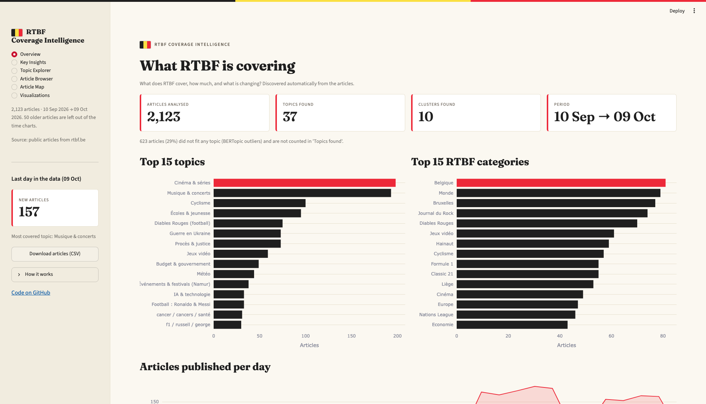

# RTBF News Analysis

An end-to-end NLP project that turns RTBF news articles into an explorable map of recurring topics. The pipeline collects and validates articles, creates multilingual embeddings, discovers topics with BERTopic, and independently groups articles with K-Means.

[Open the RTBF News Analysis dashboard](https://rtbf-news-analysis.streamlit.app/)

## Project status

The core data collection and analysis pipeline is complete. The Streamlit dashboard is live, with further dashboard improvements and the project presentation still in progress.

## Project overview

RTBF publishes articles across many subjects, making it difficult to scan recurring coverage themes across a large corpus. This project collects public RTBF articles, cleans them, represents their meaning with multilingual sentence embeddings, and analyzes them with topic modeling and clustering. The results are prepared for exploration in a Streamlit dashboard.

## Key results

- **2,123 cleaned articles** are included in the current results snapshot.
- **37 topics** were discovered by BERTopic; **623 articles (29.3%)** were initially labeled as outliers.
- An independent K-Means analysis produced **10 semantic article clusters**, selected from candidate values between 10 and 50 using silhouette scores.
- The multilingual embedding model produced a **384-dimensional vector** for each article.

Results are based on the files currently committed under `outputs/` and will change when the pipeline is rerun on a new corpus.

## Features

- View article, topic, and cluster summaries, including coverage trends and potential gaps.
- Search topic names and keywords in the Topic Explorer.
- Filter and search articles by RTBF category, topic, date, and title; open the source article from its link.
- Explore a semantic article map, highlight topics, and color points by topic, RTBF category, or K-Means cluster.
- Explore interactive topic visualizations and download the article table as CSV.

## Pipeline

1. Collect article URLs and parse article metadata and text from RTBF pages.
2. Clean and validate the corpus, removing duplicate titles, non-news pages, and articles shorter than 500 characters.
3. Generate multilingual sentence embeddings with `src/embeddings.py` using `paraphrase-multilingual-MiniLM-L12-v2`.
4. Fit BERTopic with UMAP and HDBSCAN to discover article topics and create topic visualizations.
5. Independently run K-Means on the same article embeddings. Select the cluster count by comparing silhouette scores over candidate values from 10 to 50.
6. Compare topic assignments with RTBF categories as a qualitative validation check.
7. Explore the generated results in the Streamlit dashboard.

During quality checks, the article text was reviewed for common page boilerplate such as “Lire aussi,” newsletter prompts, advertising, cookie notices, and subscription prompts. These appeared infrequently, so the corpus was not aggressively stripped of text. The final cleaned corpus contains 2,123 of the 2,161 collected records; average article length is about 2,900 characters.

Example discovered themes include film and television, music, cycling, education, football, justice, the war in Ukraine, video games, government, weather, artificial intelligence, health, Formula 1, museums, gardening, public transport, the Middle East conflict, and tennis. Topic/category matches (for example, artificial intelligence with RTBF’s High Tech category) provide a useful sanity check, while mixed or broad categories still require human review.

The analysis uses Sentence Transformers, UMAP, HDBSCAN, and BERTopic. Data collection and processing use Python, Playwright, Requests, BeautifulSoup, pandas, and NumPy; visualizations use Plotly and Streamlit.

Sentence Transformers create multilingual semantic embeddings. BERTopic uses UMAP and HDBSCAN to form topic groups and can leave outliers unassigned. K-Means runs separately over the same embeddings and assigns every article to one of a fixed number of clusters. These are complementary views of the corpus, not a sequential step in which K-Means clusters the BERTopic topics. Topic assignments were compared with RTBF categories, but category agreement is only a sanity check; it does not by itself establish topic quality. Topic labels combine keywords with manual names and should be reviewed against representative articles.

## Repository structure

```text
.
├── .streamlit/          # Streamlit theme
├── assets/              # README screenshots
├── dashboard/
│   ├── app.py            # Streamlit dashboard
│   └── requirements.txt  # Dashboard dependencies
├── data/
│   ├── raw/             # Collected URLs and scraped articles
│   └── processed/       # Cleaned article corpus
├── outputs/             # Topic, cluster, map, and visualization results
├── src/                 # Collection, processing, and modeling scripts
├── tests/               # Scraper check
├── RTBF_Coverage_Intelligence.ppt  # Legacy PowerPoint deck
├── .gitignore
├── README.md
└── requirements.txt     # Full pipeline dependencies
```

## Setup and run

Requires Python 3. Create an environment and install dependencies:

**Python 3.11** is recommended for a consistent local setup. The optional development-container configuration is not included in this repository.

```bash
python3 -m venv nlp-env
source nlp-env/bin/activate
pip install -r requirements.txt
```

Run the pipeline from the project root. The repository scripts currently split scraping and parsing across their own steps; use the collection scripts present under `src/`:

```bash
python src/archive.py
python src/scrape_articles.py
python src/preprocessing.py
python src/embeddings.py
python src/topic_modeling.py
python src/clustering.py
python src/make_doc_map.py
streamlit run dashboard/app.py
```

Scraping requires Playwright's Chromium browser. Install it once with `playwright install chromium` if needed. Topic visualizations are exported as interactive HTML charts.

## Screenshots

The article map appears near the top of this README. The dashboard overview and topic word-score chart are shown here:



[Open the interactive topic word-score chart](outputs/topics_barchart.html)

## Main files

- `data/raw/articles.csv` — scraped article records
- `data/processed/articles_clean.csv` — cleaned article corpus
- `data/processed/embeddings.npy` — generated semantic vectors (not committed)
- `outputs/articles_with_clusters.csv`, `outputs/cluster_summary.csv` — cluster assignments and summaries
- `outputs/articles_with_topics.csv`, `outputs/topic_info.csv` — topic assignments and topic summaries
- `outputs/*.html` — interactive topic and document visualizations

Topic labels are automated summaries of semantic groups, not a definitive news taxonomy. Review representative articles and validate labels before drawing editorial conclusions.

## Project details

- **Timeline:** 4 days
- **Author:** [Hussein Abuammar](https://www.linkedin.com/in/hussein-abuammar)
- **Work sequence:** article collection and cleaning, embeddings and modeling, dashboard development, and deployment.
- **GitHub:** [husseinabuammar24-cloud](https://github.com/husseinabuammar24-cloud) · [Project repository](https://github.com/husseinabuammar24-cloud/rtbf_news_analysis)

High-level breakdown of the four-day project:

| Day | Work |
| --- | --- |
| 1 | Collect and parse RTBF articles; clean the corpus. |
| 2 | Generate embeddings and evaluate K-Means clusters. |
| 3 | Fit BERTopic, review topic labels, and create visualizations. |
| 4 | Build the dashboard, deploy it, and document the project. |

## Current status and next steps

- **Dashboard:** live on [Streamlit Community Cloud](https://rtbf-news-analysis.streamlit.app/). Planned improvements include key insights, coverage gaps, topic trends, and business recommendations, alongside article, topic, cluster, and visualization views.
- **Deployment:** hosted on Streamlit Community Cloud.
- **Presentation:** prepare a concise project presentation covering the problem, data collection, topic modeling, clustering and insights, and business value.

Collection and model generation are manual pipeline steps. Scheduling refreshes and storing current data and model artifacts are possible future improvements.

## Limitations and next steps

- **Outliers:** 623 of 2,123 articles (29.3%) were not assigned to a BERTopic topic, so one-off or unusual stories are not represented by the topic summaries.
- **Dates:** 50 records fall outside the latest 30-day window used for trend views. Some publication dates are unexpectedly old or may reflect archive metadata, so date-based conclusions need checking.
- **Labels:** Topic labels are generated from keywords and selectively renamed by hand. Review representative articles before treating a label as a definitive classification.
- **Next steps:** review date anomalies and outlier handling, validate topic labels with representative articles, and automate the refresh pipeline if the dashboard is used continuously.

## Acknowledgements and license

Built as a BeCode project using public articles from RTBF. No software license file is currently included in the repository.
