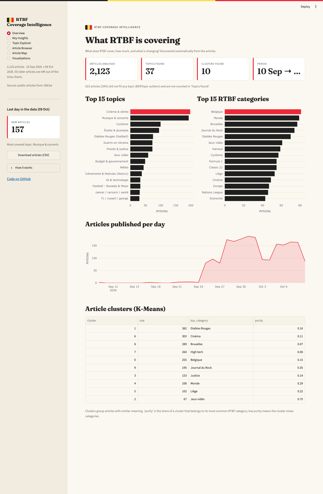
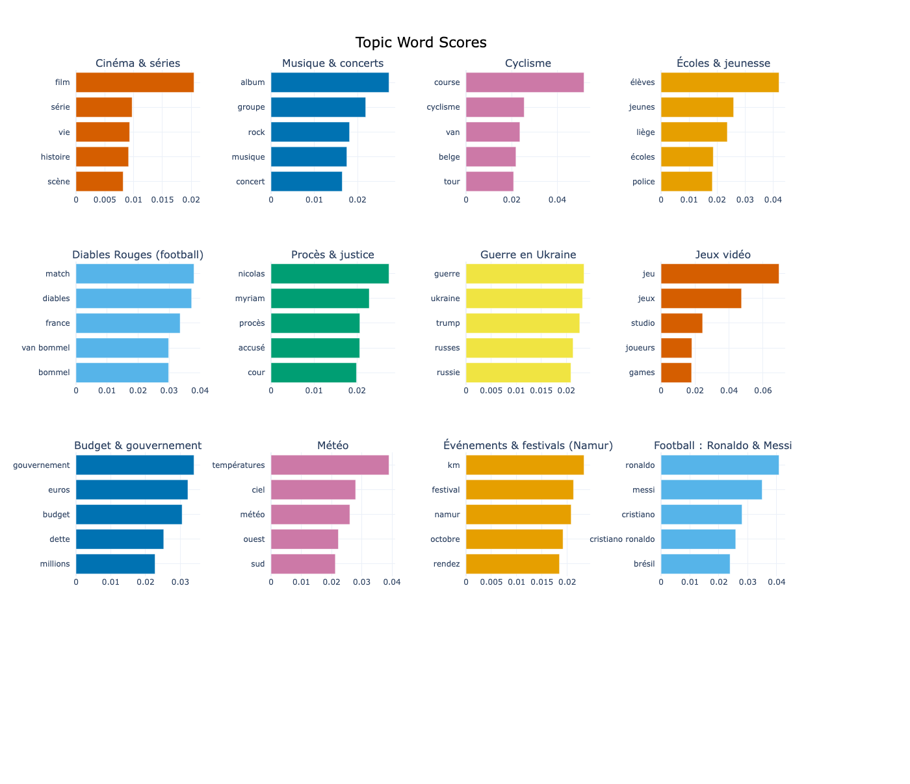
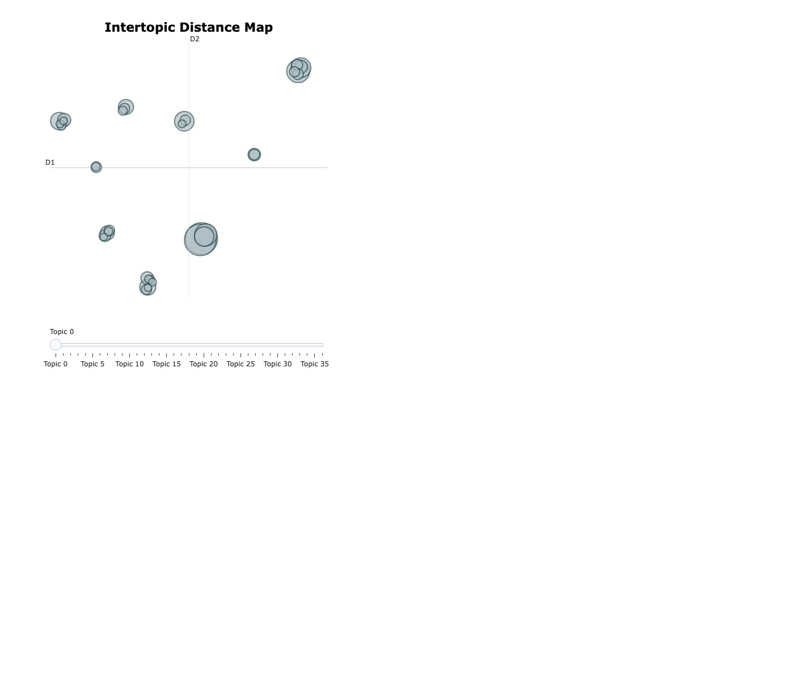

# RTBF News Analysis

This project analyzes RTBF news coverage by collecting article URLs, extracting article content, cleaning the dataset, generating multilingual embeddings, clustering the articles, and modeling topics with BERTopic.

The goal is to turn a large set of RTBF articles into a structured, analyzable corpus and to surface the main editorial themes present in the coverage.

This project was completed over a 4-day sprint as a focused end-to-end data analysis and NLP workflow.

## Project overview

The pipeline follows a standard research/data project flow:

1. Collect RTBF article URLs
2. Download and parse article metadata and content
3. Clean and validate the raw article corpus
4. Generate semantic embeddings for each article
5. Cluster articles and identify topical groups
6. Export topic summaries and interactive visualizations
7. Explore the final results in a Streamlit dashboard

This is not only a scraper. It is a full news-analysis pipeline built around data quality, semantic modeling, and interpretation of results.

## Current status

Completed:
- RTBF article URL collection
- Raw article extraction and metadata parsing
- Dataset cleaning and validation
- Multilingual sentence embedding generation
- Clustering on article embeddings
- BERTopic-based topic modeling
- Topic summaries and interactive HTML outputs
- Dashboard for exploration of results

## Project snapshots

The figures below show the most important outputs of the pipeline: the interactive dashboard, the main topic distribution, and the topic map.

<p align="center">
  
</p>

<p align="center">
  
</p>

<p align="center">
  
</p>

## Data pipeline

### 1) URL collection
The project starts by crawling RTBF pages and collecting article URLs from the site.

Related script:
- `src/archive.py`

This script opens the RTBF page, dismisses the cookie banner when necessary, loads more article links, and saves the discovered URLs to:
- `data/raw/article_urls.txt`

### 2) Article scraping and extraction
Once URLs are available, the project scrapes each page and extracts structured article data:
- URL
- title
- published date
- author
- category
- article type
- lead paragraph
- article body
- article length

Related scripts:
- `src/article_parser.py`
- `src/scrape_articles.py`
- `src/build_dataset.py`

The output is stored in:
- `data/raw/articles.csv`

### 3) Data cleaning and preprocessing
Before analysis, the dataset is cleaned to remove incomplete records, duplicates, non-news pages, and very short entries. Dates are standardized and a ready-to-use text field is created for downstream modeling.

Related script:
- `src/preprocessing.py`

Output:
- `data/processed/articles_clean.csv`

### 4) Embedding generation
Each cleaned article is converted into a semantic vector representation using a multilingual sentence-transformer model.

Related script:
- `src/embeddings.py`

Output:
- `data/processed/embeddings.npy`

### 5) Clustering
The embedding space is clustered to identify groups of similar articles. This helps create an initial grouping before topic modeling.

Related script:
- `src/clustering.py`

Outputs:
- `outputs/articles_with_clusters.csv`
- `outputs/cluster_summary.csv`

### 6) Topic modeling
The project uses BERTopic with UMAP and HDBSCAN to identify major semantic themes inside the corpus.

Related script:
- `src/topic_modeling.py`

Outputs:
- `outputs/topic_info.csv`
- `outputs/topics_barchart.html`
- `outputs/topics_map.html`
- `outputs/topics_hierarchy.html`
- `outputs/topics_over_time.html`
- `outputs/documents_map.html`

### 7) Dashboard exploration
The results are visualized in a Streamlit dashboard for exploring topics, article counts, keywords, and time trends.

Related script:
- `dashboard/app.py`

Run with:
```bash
streamlit run dashboard/app.py
```

## Repository structure

```text
rtbf_news_analysis/
├── dashboard/
│   └── app.py
├── data/
│   ├── processed/
│   │   ├── articles_clean.csv
│   │   └── embeddings.npy
│   └── raw/
│       ├── article_urls.txt
│       ├── articles.csv
│       ├── failed_urls.txt
│       └── sample_article.csv
├── outputs/
│   ├── articles_with_clusters.csv
│   ├── cluster_summary.csv
│   ├── documents_map.html
│   ├── topic_info.csv
│   ├── topics_barchart.html
│   ├── topics_hierarchy.html
│   ├── topics_map.html
│   └── topics_over_time.html
├── src/
│   ├── archive.py
│   ├── article_parser.py
│   ├── build_dataset.py
│   ├── clustering.py
│   ├── embeddings.py
│   ├── make_doc_map.py
│   ├── preprocessing.py
│   ├── scrape_articles.py
│   └── topic_modeling.py
├── .gitignore
├── README.md
├── requirements.txt
└── nlp-env/
```

## Setup

1. Clone the repository
2. Create and activate a virtual environment
3. Install dependencies

```bash
python3 -m venv nlp-env
source nlp-env/bin/activate
pip install -r requirements.txt
```

## Running the full workflow

From the project root:

```bash
source nlp-env/bin/activate
```

### 1) Collect URLs
```bash
python src/archive.py
```

### 2) Scrape article content
```bash
python src/scrape_articles.py
```

### 3) Clean the data
```bash
python src/preprocessing.py
```

### 4) Generate embeddings
```bash
python src/embeddings.py
```

### 5) Cluster articles
```bash
python src/clustering.py
```

### 6) Run topic modeling
```bash
python src/topic_modeling.py
```

### 7) Build document map
```bash
python src/make_doc_map.py
```

### 8) Explore results in the dashboard
```bash
streamlit run dashboard/app.py
```

## Technical stack

### Data acquisition and parsing
- Python
- Playwright
- Requests
- BeautifulSoup
- JSON-LD extraction

### Data processing
- pandas
- NumPy
- scikit-learn

### NLP and machine learning
- SentenceTransformers
- UMAP
- HDBSCAN
- BERTopic

### Visualization
- Plotly
- Streamlit
- HTML exports

## Expected outputs

The project produces both structured data and visual summaries:

- cleaned article corpus for further analysis
- semantic embeddings for each article
- article clusters and cluster summaries
- BERTopic topic table with keywords and counts
- interactive maps and charts for topic exploration
- dashboard for manual review and editorial interpretation

## Notes and interpretation

The analysis is designed to reveal editorial themes in RTBF coverage rather than to produce a fully curated news taxonomy. The topics generated by BERTopic are semantic clusters, which can be refined with manual labeling and additional editorial validation.

In practice, the outputs are useful for:
- identifying dominant themes in RTBF news coverage
- comparing article groups over time
- spotting emerging editorial trends
- exploring which categories, topics, and narratives shape the corpus

## Summary

This project turns RTBF article data into a coherent NLP pipeline: from raw URL collection to semantic topic discovery. It creates a reusable framework for data extraction, text cleaning, embedding generation, clustering, and topical analysis, and it includes a dashboard to make the results interpretable and explorable.
