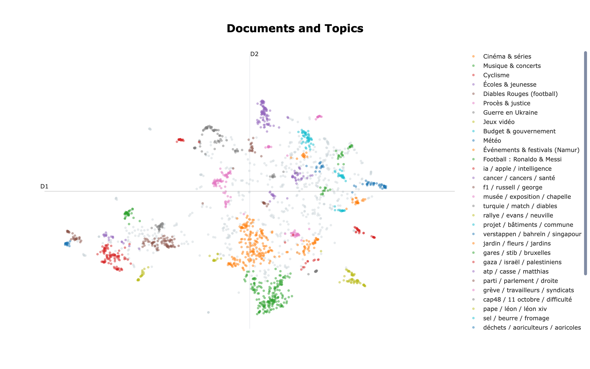

# RTBF News Analysis

An end-to-end NLP project that turns RTBF news articles into an explorable map of recurring topics. The workflow collects and parses articles, cleans the corpus, creates multilingual embeddings, clusters similar stories, and models topics with BERTopic.

## Live dashboard

[Open RTBF News Analysis](https://rtbf-news-analysis.streamlit.app/)



## Pipeline

1. Collect article URLs with `src/archive.py`.
2. Scrape article metadata and text with `src/scrape_articles.py` and `src/article_parser.py`.
3. Clean and validate the corpus with `src/preprocessing.py`.
4. Generate multilingual sentence embeddings with `src/embeddings.py`.
5. Cluster articles with `src/clustering.py`.
6. Discover and summarize topics with `src/topic_modeling.py` and build the document map with `src/make_doc_map.py`.
7. Explore results in the Streamlit dashboard.

The analysis uses Sentence Transformers, UMAP, HDBSCAN, and BERTopic. Data collection and processing use Python, Playwright, Requests, BeautifulSoup, pandas, and NumPy; visualizations use Plotly and Streamlit.

## Repository structure

```text
.
├── .devcontainer/       # Development container settings
├── .streamlit/          # Streamlit theme
├── dashboard/
│   ├── app.py            # Streamlit dashboard
│   └── requirements.txt  # Dashboard dependencies
├── data/
│   ├── raw/             # Collected URLs and scraped articles
│   └── processed/       # Cleaned article corpus
├── outputs/             # Topic, cluster, map, and visualization results
├── src/                 # Collection, processing, and modeling scripts
├── tests/               # Scraper check
├── .gitignore
├── README.md
└── requirements.txt     # Full pipeline dependencies
```

## Setup and run

Requires Python 3. Create an environment and install dependencies:

```bash
python3 -m venv nlp-env
source nlp-env/bin/activate
pip install -r requirements.txt
```

Run the pipeline from the project root, in order:

```bash
python src/archive.py
python src/scrape_articles.py
python src/preprocessing.py
python src/embeddings.py
python src/clustering.py
python src/topic_modeling.py
python src/make_doc_map.py
streamlit run dashboard/app.py
```

Scraping and PNG chart export require Playwright's Chromium browser. Install it once with `playwright install chromium` if needed.

## Main files

- `data/raw/articles.csv` — scraped article records
- `data/processed/articles_clean.csv` — cleaned article corpus
- `data/processed/embeddings.npy` — generated semantic vectors (not committed)
- `outputs/articles_with_clusters.csv`, `outputs/cluster_summary.csv` — cluster assignments and summaries
- `outputs/articles_with_topics.csv`, `outputs/topic_info.csv` — topic assignments and topic summaries
- `outputs/*.png` — static topic and document visualizations

Topic labels are automated summaries of semantic groups, not a definitive news taxonomy. Review representative articles and validate labels before drawing editorial conclusions.

## Project details

- **Timeline:** 4 days
- **Author:** [Hussein Abuammar](https://www.linkedin.com/in/hussein-abuammar)
